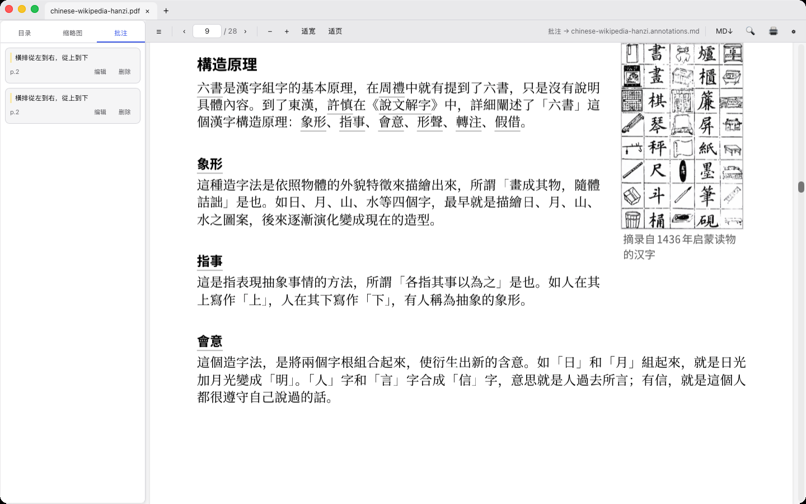

# SoloPDF

> 無料・広告なし・完全ローカル動作のクロスプラットフォーム PDF リーダー＆オフライン文書ツールキット —— **ハイライトがそのままプレーンな Markdown ノート（`.annotations.md`）になります。**

[](https://github.com/zhitongblog/solopdf/releases/latest)
[](LICENSE)
[](https://github.com/zhitongblog/solopdf/releases)
[](https://github.com/zhitongblog/solopdf/stargazers)
[](https://apps.apple.com/app/id6787712953)
[](https://solopdf.doaipm.com)

🌐 **[English](README.md) · [简体中文](README.zh.md) · [日本語](README.ja.md)**

[**最新版をダウンロード**](https://github.com/zhitongblog/solopdf/releases/latest) · [**App Store (macOS & iOS)**](https://apps.apple.com/app/id6787712953) · [**v1.1 更新履歴**](CHANGELOG.md) · [**公式サイト**](https://solopdf.doaipm.com) · [**連携アプリ：SoloMD**](https://solomd.app)

⭐ **SoloPDF を気に入っていただけたら、ぜひ GitHub で [Star](https://github.com/zhitongblog/solopdf) をお願いします！**（完全無料・広告ゼロ・MIT ライセンスのオープンソースプロジェクトです）

<p align="center">
  
</p>

---

## SoloPDF の特徴

1. **ハイライト ＝ Markdown ファイル（`.annotations.md`）**
   PDF に引いたハイライト・下線・付箋・手書き・範囲スクリーンショットは、同じフォルダ内の `.annotations.md` に自動保存されます。[SoloMD](https://solomd.app) や Obsidian、VS Code、Git でそのまま編集・検索・バージョン管理でき、`solopdf://` リンクから元のページ位置へ一瞬でジャンプできます。
2. **Docker 不要・約 24 MB のネイティブ Stirling-PDF 級オフラインツール群（Copy-out 原則）**
   **Tauri 2 + Vue 3 + Rust** 製。スキャン傾き自動補正（Auto-Deskew）、Sauvola 適応二値化（スマホ撮影の影除去）、見開きスキャン中央分割（右綴じ漫画・古書対応）、17 ステップの一括パイプライン、完全墨消し（Redact）、小冊子・N-up 面付け、X.509 電子署名検証など 20 以上の機能を完全オフラインで実行。**元の PDF ファイルは一切変更しません。**
3. **学術研究・法務レビュー支援**
   数式を囲んで **LaTeX（`$...$` / `$$...$$`）** に変換、表を囲んで **Markdown / CSV** に抽出、複数論文の `#タグ` 注釈を集約する **トピック総説出力**、**Anki / Obsidian 暗記カード出力**、さらにスキャン契約書や図面の微細な変更を見抜く **赤青ピクセルオーバーレイ＆ A↔B 点滅比較（Blink Diff）** を搭載。
4. **CLI ＆ 56 ツールの MCP サーバー内蔵**
   Claude Code、Claude Desktop、Cursor からローカル PDF の検索（BM25）、OCR、比較、墨消し、分割・結合を直接操作できます。

---

## インストール

```bash
# macOS (Homebrew)
brew install --cask zhitongblog/tap/solopdf

# Windows (Scoop)
scoop bucket add zhitongblog https://github.com/zhitongblog/scoop-bucket
scoop install solopdf
```

- **macOS (Apple Silicon & Intel Universal)**：[**GitHub Releases**](https://github.com/zhitongblog/solopdf/releases/latest)（`SoloPDF_*_universal.dmg`）または [**Mac App Store**](https://apps.apple.com/app/id6787712953)
- **Windows (x64 & ARM64)**：[**GitHub Releases**](https://github.com/zhitongblog/solopdf/releases/latest)（オフライン PP-OCRv4 モデル同梱）
- **Linux (x64 & ARM64)**：[**GitHub Releases**](https://github.com/zhitongblog/solopdf/releases/latest)（`.AppImage` / `.deb`）
- **iOS / iPadOS**：[**App Store**](https://apps.apple.com/app/id6787712953)
- **Android**：[**GitHub Releases**](https://github.com/zhitongblog/solopdf/releases/latest)（`app-universal-release.apk`）

---

## MCP サーバー接続例

```bash
# 読み取り専用（25 ツール）：
claude mcp add solopdf -- node /path/to/solopdf/dev-mcp/src/index.mjs

# Copy-out 文書編集・注釈追加も有効化（計 56 ツール）：
claude mcp add solopdf -- node /path/to/solopdf/dev-mcp/src/index.mjs --allow-write
```

## ライセンス

[MIT](LICENSE) · サードパーティライセンス表記は [NOTICE.md](NOTICE.md) をご覧ください。
