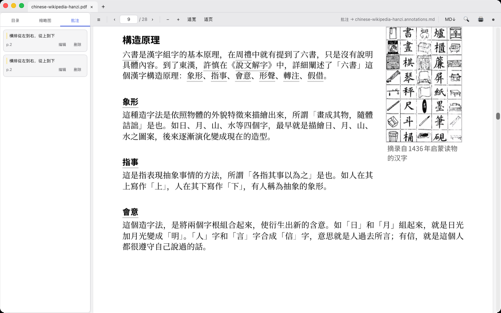
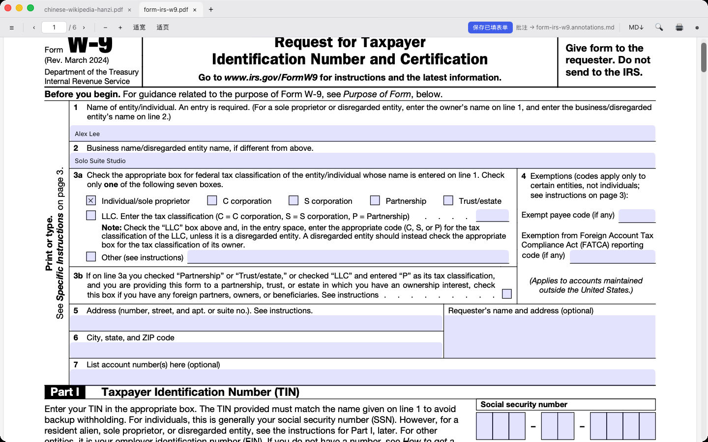
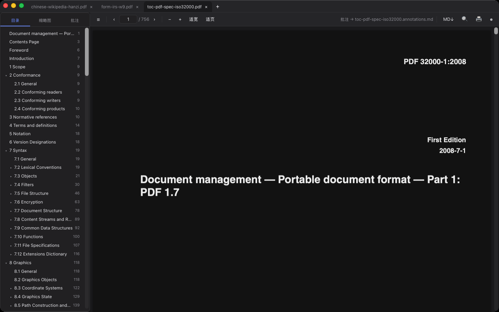

# SoloPDF

> Free, ad-free, local-first PDF reader & offline document toolkit — where every highlight becomes a plain Markdown file.

[](https://github.com/zhitongblog/solopdf/releases/latest)
[](LICENSE)
[](https://github.com/zhitongblog/solopdf/releases)
[](https://github.com/zhitongblog/solopdf/stargazers)
[](https://apps.apple.com/app/id6787712953)
[](https://solopdf.doaipm.com)

🌐 **[English](README.md) · [简体中文](README.zh.md) · [日本語](README.ja.md)**

[**Download Latest Release**](https://github.com/zhitongblog/solopdf/releases/latest) · [**App Store (macOS & iOS)**](https://apps.apple.com/app/id6787712953) · [**What's New in v1.1**](CHANGELOG.md) · [**Website**](https://solopdf.doaipm.com) · [**Companion App: SoloMD**](https://solomd.app)

⭐ **If SoloPDF earns a place on your machine, [star it on GitHub](https://github.com/zhitongblog/solopdf)** — it is 100% free, ad-free, MIT-licensed, and stars are how other readers, researchers, and developers find it.

<p align="center">
  
</p>

<details>
<summary>📸 More screenshots (Fillable AcroForms · Dark Mode & Large Spec Outline)</summary>
<br />
<p align="center">
  
  
</p>
</details>

---

## Why SoloPDF?

Desktop PDF readers today force an ugly trade-off: bloatware that nags you with ads and cloud upsells (Adobe / Foxit / WPS), barebones browser tabs (Edge / Chrome), or self-hosted web suites like Stirling-PDF that require running Docker + a 1.5 GB JVM just to deskew a scan or redact a contract. Meanwhile, PKM tools lock your highlights inside opaque SQLite databases.

**SoloPDF** is built on **Tauri 2 + Vue 3 + Rust** (~24 MB macOS Universal `.dmg`, native across **macOS, Windows x64/ARM64, Linux x64/ARM64, iOS/iPadOS, and Android**):

1. **Highlights = Plain Markdown (`.annotations.md`).** Every highlight, underline, sticky note, freehand sketch, and region screenshot is saved right next to your PDF as a human-readable Markdown file with `solopdf://` deep links. Open and edit it in [SoloMD](https://solomd.app), Obsidian, VS Code, or Git — triple-layer anchoring (`text fingerprint > page + coordinates`) keeps highlights attached even if the PDF is re-exported, and your notes never get overwritten.
2. **20+ Offline PDF Tools in Pure Rust (Strict Copy-Out).** Auto-deskew, Sauvola adaptive binarization, 2-up scan split, 17-step batch pipelines, true content-stream redaction, N-up & saddle-stitch booklet imposition, X.509/PKCS#7 signature verification, lossless image extraction, and smart outline generation — zero Docker, zero Java, zero network uploads, and **your original PDF is never modified in place**.
3. **Academic & Legal Superpowers.** Drag a box to snip math formulas into **LaTeX** (`$...$` / `$$...$$`) or tables into **Markdown / CSV**; aggregate `#tags` across dozens of papers into a **Cross-PDF Topic Digest**; export **Anki / Obsidian flashcards**; or run **Visual Pixel Overlay & A↔B Blink Compare** to catch subtle contract or CAD revisions in seconds.
4. **AI-Native CLI + 56-Tool MCP Server.** Drive every reading, retrieval (offline BM25 with `[p.N]` citations), OCR, comparison, and document operation from your terminal or directly inside **Claude Code, Claude Desktop, Cursor, and Windsurf**.

| Capability | SoloPDF | Adobe / Foxit | PDF Expert | Stirling-PDF | Zotero |
| :--- | :---: | :---: | :---: | :---: | :---: |
| **Price & License** | **Free · MIT** | Freemium / Sub | Paid ($80+/yr) | Free · Self-host | Free · AGPL |
| **Install Footprint** | **~24 MB native** | 500 MB – 2 GB | ~180 MB (Apple only) | Docker + JVM (~1.5 GB) | ~250 MB |
| **Ads / Telemetry / Account** | **Zero** | Heavy upsells | Account nag | Zero | Optional sync |
| **Annotations Format** | **Plain `.annotations.md`** | Locked in PDF | Locked in PDF | N/A | SQLite DB |
| **Visual Pixel & Blink Diff** | **Built-in (Anaglyph + Blink)** | Paid Pro only | No | Limited | No |
| **Scan Deskew + Sauvola Binarize** | **17-step Rust pipeline** | Paid Pro only | No | Docker required | No |
| **Math → LaTeX & Table → MD Snip** | **100% Offline** | No | No | No | Plugins needed |
| **True Content-Stream Redaction** | **Built-in (Offline)** | Paid Pro only | Paid | Yes | No |
| **CLI + MCP Server for AI Agents** | **CLI + 56 MCP Tools** | No | No | REST API | 3rd-party MCP |
| **Platforms** | **Mac · Win · Linux · iOS · Android** | Mac · Win · Mobile | Mac · iOS | Web (Docker) | Mac · Win · Linux · iOS · Android |

---

## What's New in v1.1

- **Scan Mastery Closed Loop** — **Auto-Deskew & border cleanup** (projection profile variance maximization + bilinear rotation), **Sauvola local adaptive binarization** ($O(1)$ integral-image windowing that eliminates phone-camera shadows), **2-up scan center-gutter split** (supports skipping single-page covers and RTL manga/ancient texts), **Single continuous vector page stitch**, **blank scan ink-ratio detection & removal**, and **vector PDF letterhead overlay**.
- **Visual Page Comparison (Overlay & Blink Diff)** — Alongside word/character-level text diff, inspect scanned contracts, stamps, and CAD drawings with **Red/Cyan pixel anaglyph overlay**, **16×16 connected-component change hotspots (`Δ X.XX%`)**, and **650 ms A ↔ B Blink Compare**.
- **Math Snip → LaTeX & Cross-PDF `#tag` Topic Digest** — Box-select equations on any page to copy inline `$...$` or display `$$...$$` LaTeX (superscripts/subscripts, stacked fractions, radicals, Greek/calculus symbols). Aggregate `.annotations.md` across open tabs or an entire literature folder by `#tag` (`#method`, `#limitation`, etc.) into a structured Markdown synthesis ready for SoloMD or Obsidian.
- **17-Step In-Memory Pipeline & Multi-File Batch Queue** — Chain up to 17 atomic PDF operations in memory (5 built-in presets: *Scan Cleanup*, *Crisp B&W Scan*, *Confidential Share*, *Handout Print*, *Archive Slim*) and run them across a batch of PDFs in one go, plus **Smart Auto-Rename** (`{year} - {author} - {title}.pdf`) and `/EmbeddedFiles` attachment read/write/strip.

---

## Core Capabilities

### Reading & Companion Markdown Notes
- **Highlight → `.annotations.md`**: Highlights, underlines, strikethroughs, squiggly lines, sticky notes, freehand ink, and **region screenshots** (saved in `<doc>.annotations.assets/` and referenced via standard `` Markdown) sync live with your companion `.annotations.md` file.
- **Bi-directional Round-Trip**: Import existing PDF annotations left by Acrobat, Apple Preview, PDF Expert, Zotero, or Foxit in one click (undoable, deduplicated, non-destructive). Export companion notes back into a new standard-annotated PDF copy anytime.
- **Instant Streaming & CJK-First Search**: Cold-starts a 157 MB / 1,048-page PDF in ~1s with constant-memory virtual scrolling. Full-text search normalizes NFKC codepoints (fixing the notorious Kangxi radical mismatch in Skia-exported PDFs).
- **Side-by-Side Split & Reading Aids**: View two sections of the same PDF or two separate PDFs side-by-side (with optional page-locked sync scroll), smart dark mode (inverts text pages while keeping photo-heavy pages intact), auto-crop margins for two-column papers, column-aware **Reading Ruler** (`L`), **2–4× HD Loupe** (hold `Z`), and built-in offline Chinese-English dictionary (CC-CEDICT).
- **Multi-Format**: **PDF · EPUB · MOBI/AZW3 · FB2 (`.fb2`/`.fbz`, auto encoding detection) · TXT · CBZ/CBR comics · DjVu · Multi-page TIFF** (CCITT G3/G4 fax, LZW, Deflate, JPEG).

### 100% Local OCR & Optional BYOK AI
- **On-Device OCR (Zero Network)**: Turn scanned PDFs or camera photos into **searchable PDFs** (Tesseract-style invisible `GlyphLessFont` text layer — selectable, searchable, and highlightable without bloating file size) or structured **Markdown**. Uses Apple **Vision** on macOS/iOS (zero bundle overhead) and bundled **PP-OCRv4 ONNX** on Windows/Linux.
- **Ask AI (Off by Default, BYOK / Local Ollama)**: Point SoloPDF at your own `http://localhost:11434/v1` (Ollama / LM Studio) or OpenAI-compatible key for streamed Q&A with `[p.N]` page citations and map-reduce long-document summaries. Explicit endpoint consent before a single byte leaves the app.

### Complete Offline Document Toolkit (Copy-Out Only)
- **Outlines / Bookmarks**: Visual tree editor + 1-click smart outline generator from heading font-size gradients or chapter regexes (`Chapter N`, `1.1`, `第X章`).
- **Imposition & Prepress**: **N-up** (`2/4/6/9/16` pages per sheet, vector `/Form XObject`), **Saddle-stitch Booklet**, **2-up Split**, **Single Continuous Page**, **Grayscale + scan background whitening**, **Normalize Page Size** (`A4`/`A3`/`Letter`/`Legal`), and **Auto-Crop margins** (with symmetric odd/even binding gutters).
- **Watermarks, Stamps & Measurement**: Tiled/diagonal CJK text & alpha PNG watermarks, **Bates numbering** (`DOC-{n:06}`, outside-edge alignment), **8 localized vector stamps** + dynamic signer/date stamps, and calibrated **scale ruler** for distance, perimeter, and polygon area (`mm`/`cm`/`m`/`in`/`pt`).
- **Security, True Redaction & Digital Signatures**: AES-256 open passwords, **true content-stream Redaction** (strips underlying `Tj`/`TJ` operators — impossible to copy-paste underneath — with built-in phone/email/ID/card/IPv4 regex presets), metadata & script **Sanitization**, AcroForm filling & **Flattening**, and **X.509 / PKCS#7 signature verification & signing**.

---

## Install

```bash
# macOS (Homebrew)
brew install --cask zhitongblog/tap/solopdf

# Windows (Scoop)
scoop bucket add zhitongblog https://github.com/zhitongblog/scoop-bucket
scoop install solopdf
```

- **macOS (Apple Silicon & Intel Universal)**: Download `SoloPDF_*_universal.dmg` from [**GitHub Releases**](https://github.com/zhitongblog/solopdf/releases/latest), run `brew install --cask zhitongblog/tap/solopdf`, or install from the [**Mac App Store**](https://apps.apple.com/app/id6787712953).
- **Windows (x64 & ARM64)**: Download `*-setup.exe` or `*.msi` from [**GitHub Releases**](https://github.com/zhitongblog/solopdf/releases/latest) (offline PP-OCRv4 models included), or install via Scoop above.
- **Linux (x64 & ARM64)**: Download `*.AppImage` or `*.deb` from [**GitHub Releases**](https://github.com/zhitongblog/solopdf/releases/latest).
- **iOS / iPadOS**: [**App Store**](https://apps.apple.com/app/id6787712953).
- **Android**: Download `app-universal-release.apk` from [**GitHub Releases**](https://github.com/zhitongblog/solopdf/releases/latest).

---

## Drive PDFs from Claude Code, Cursor, or Terminal (MCP + CLI)

### MCP Server (`56` tools: `25` read-only + `31` write-gated)

```bash
# Read-only mode (safe inspection, search, BM25 retrieval, math/table snip, visual/text diff):
claude mcp add solopdf -- node /path/to/solopdf/dev-mcp/src/index.mjs

# Enable Copy-out document & annotation tools (--allow-write):
claude mcp add solopdf -- node /path/to/solopdf/dev-mcp/src/index.mjs --allow-write
```

- **Read-only tools (25)**: `solopdf_info` · `solopdf_extract_text` · `solopdf_search` · `solopdf_search_library` · `solopdf_retrieve` *(local BM25 chunks with page numbers, zero LLM calls)* · `solopdf_read_annotations` · `solopdf_pdf_annotations` · `solopdf_page_image` · `solopdf_links` · `solopdf_attachments` · `solopdf_layers` · `solopdf_outlines` · `solopdf_cite` · `solopdf_auto_rename` · `solopdf_compare` · `solopdf_visual_diff` · `solopdf_extract_table` · `solopdf_extract_math` · `solopdf_export_markdown` · `solopdf_export_flashcards` · `solopdf_export_digest` · `solopdf_detect_blank_pages` · `solopdf_verify_signatures` · `solopdf_define` · `solopdf_translate`
- **Write-gated tools (`--allow-write`, 31 — all Copy-out)**: `solopdf_add_annotation` · `solopdf_import_annotations` · `solopdf_export_annotated_pdf` · `solopdf_pages` · `solopdf_merge` · `solopdf_split_by_bookmarks` · `solopdf_split_2up` · `solopdf_single_page` · `solopdf_remove_blank_pages` · `solopdf_deskew` · `solopdf_binarize` · `solopdf_crop` · `solopdf_nup` · `solopdf_booklet` · `solopdf_grayscale` · `solopdf_resize_pages` · `solopdf_overlay` · `solopdf_watermark` · `solopdf_page_numbers` · `solopdf_write_outlines` · `solopdf_extract_images` · `solopdf_extract_attachment` · `solopdf_add_attachments` · `solopdf_remove_attachments` · `solopdf_sanitize` · `solopdf_flatten` · `solopdf_redact` · `solopdf_redact_by_text` · `solopdf_cert_sign` · `solopdf_pipeline` · `solopdf_batch_pipeline`

### Command Line (`solopdf`)

```bash
# Reading, Search, Citations, Snipping & Synthesis
node cli/src/index.mjs info paper.pdf                        # pages, outlines, metadata (PDF / FB2 / TIFF)
node cli/src/index.mjs extract-text paper.pdf --pages 1-5
node cli/src/index.mjs search ./papers "transformer"         # cross-library search
node cli/src/index.mjs retrieve paper.pdf "loss function" --k 6  # local BM25 top-k chunks -> JSON
node cli/src/index.mjs cite paper.pdf --format bibtex        # bibtex | apa | gbt | all | json
node cli/src/index.mjs auto-rename paper.pdf --out-dir ./clean
node cli/src/index.mjs extract-table paper.pdf --page 3 --format md
node cli/src/index.mjs extract-math paper.pdf --page 2 --rect 80,200,420,90
node cli/src/index.mjs export-flashcards paper.pdf --format anki
node cli/src/index.mjs export-digest ./papers --out review.md # cross-PDF #tag literature synthesis
node cli/src/index.mjs compare v1.pdf v2.pdf --visual-page 1 --visual-out diff.png
node cli/src/index.mjs ocr scan.pdf --out scan-searchable.pdf

# Native Rust PDF Engine (solopdf-doc — strictly writes new files)
node cli/src/index.mjs doc deskew scan.pdf fixed.pdf --clean-borders 1
node cli/src/index.mjs doc binarize scan.pdf crisp-bw.pdf --window 31 --k 0.2
node cli/src/index.mjs doc split-2up book-scan.pdf single.pdf --only-wide 1
node cli/src/index.mjs doc pipeline raw.pdf clean.pdf steps.json
node cli/src/index.mjs doc batch-pipeline out-dir/ steps.json a.pdf b.pdf c.pdf
node cli/src/index.mjs redact-text contract.pdf --presets phone,email,idcard --out redacted.pdf
node cli/src/index.mjs verify-signatures signed.pdf
```

---

## Companion Markdown Format

```markdown
# "Document Title" Annotations
<!-- solopdf:meta v1 name=... -->

## p.23 — Highlight <!-- solopdf:id a1b2c3 -->
> Quoted passage from the PDF
Your own note (edit freely in SoloMD, Obsidian, or Vim — SoloPDF never clobbers your prose)
[Jump to passage](solopdf://open?file=...&page=23&annot=a1b2c3)
<!-- solopdf:anchor a1b2c3 {"page":23,...} -->
```

Rule: SoloPDF only updates or appends blocks by `anchor id` and never rewrites the whole file; deleting an anchor comment gracefully degrades that entry to a plain note.

---

## Architecture & Development

```text
app/            Tauri 2 + Vue 3 + Rust desktop & mobile app (pdfops, OCR, DjVu)
core/           Shared domain logic: sidecar format, triple anchoring, diff, math/table snip, digest
cli/            solopdf CLI (shares exact pdf.js + core engine with the app)
dev-mcp/        56-tool Model Context Protocol server for AI agents
test-fixtures/  Standard acceptance fixtures
```

```bash
pnpm install
pnpm --filter @solopdf/core build
pnpm --filter @solopdf/core test                             # 311 unit tests
cargo test --lib --manifest-path app/src-tauri/Cargo.toml    # Rust pdfops / signature / scan tests
node scripts/check-i18n.mjs                                  # 4 locales parity check (zhCN/zhTW/en/ja)
pnpm tauri dev
```

Third-party notices: [NOTICE.md](NOTICE.md).

## License

[MIT](LICENSE)
