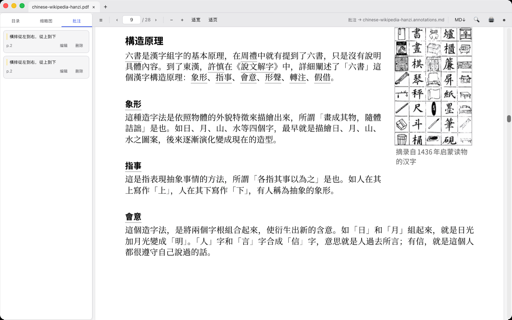
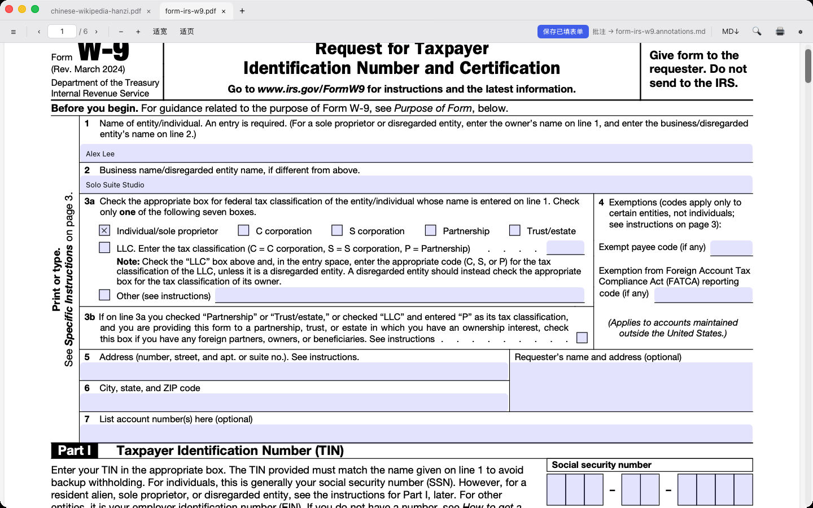
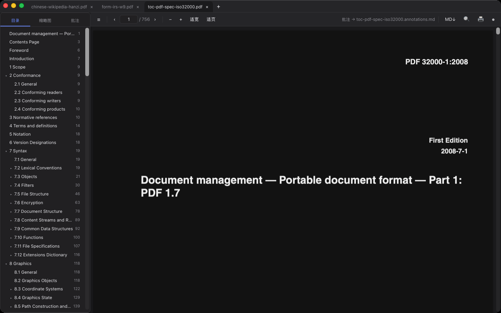

# SoloPDF

> 免费 · 无广告 · 本地优先的跨平台 PDF 阅读器与全离线文档工具箱 —— **高亮即笔记**，你在 PDF 里划的每一条高亮都自动保存为普通 Markdown 文件。

[](https://github.com/zhitongblog/solopdf/releases/latest)
[](LICENSE)
[](https://github.com/zhitongblog/solopdf/releases)
[](https://github.com/zhitongblog/solopdf/stargazers)
[](https://apps.apple.com/app/id6787712953)
[](https://solopdf.doaipm.com)

🌐 **[English](README.md) · [简体中文](README.zh.md) · [日本語](README.ja.md)**

[**下载最新版 (GitHub Releases)**](https://github.com/zhitongblog/solopdf/releases/latest) · [**App Store (macOS & iOS)**](https://apps.apple.com/app/id6787712953) · [**v1.1 更新日志**](CHANGELOG.md) · [**官方网站**](https://solopdf.doaipm.com) · [**姊妹应用：SoloMD**](https://solomd.app)

⭐ **如果 SoloPDF 对你有帮助，欢迎点亮右上角 [Star](https://github.com/zhitongblog/solopdf)** —— 100% 免费开源、零广告、零遥测，你的 Star 是让更多人发现它的最好方式。

<p align="center">
  
</p>

<details>
<summary>📸 查看更多截图（AcroForm 表单填写 · 智能暗色模式与千页目录树）</summary>
<br />
<p align="center">
  
  
</p>
</details>

---

## 为什么做 SoloPDF

桌面上的 PDF 工具长期让人左右为难：商业软件臃肿弹广告、诱导开会员上云（Adobe / 福昕 / WPS）；浏览器自带阅读器功能简陋；像 Stirling-PDF 这样的优秀工具又必须挂 Docker + 1.5 GB Java 运行时；而知识管理软件往往把你的高亮锁死在私有 SQLite 数据库里。

**SoloPDF** 基于 **Tauri 2 + Vue 3 + Rust** 原生构建（macOS 双架构通用包仅 ~24 MB，覆盖 **macOS · Windows x64/ARM64 · Linux x64/ARM64 · iOS/iPadOS · Android**）：
- **高亮即 `.annotations.md`**：伴生文件就是普通 Markdown，[SoloMD](https://solomd.app)、Obsidian、VS Code 都能直接打开编辑、RAG 能搜索、Git 能做版本管理。
- **20+ 项全离线文档工具（纯 Rust 原生，无需 Docker/Java）**：严格遵循 **Copy-out 铁律**，所有处理一律输出新文件，原 PDF 永不修改。
- **内置 CLI + 56 个工具的 MCP Server**：一行命令接入 Claude Code / Cursor / Claude Desktop，合同与论文全程不出本机。

| 核心维度 | SoloPDF | Adobe / 福昕 / WPS | PDF Expert | Stirling-PDF | Zotero |
| :--- | :---: | :---: | :---: | :---: | :---: |
| **价格与开源协议** | **永久免费 · MIT** | 免费版弹窗 / 订阅制 | 买断或订阅 (¥500+/年) | 免费开源 | 免费开源 (存储付费) |
| **安装包体积与依赖** | **~24 MB 原生秒开** | 500 MB – 2 GB | ~180 MB (仅苹果生态) | 需 Docker + JVM (~1.5 GB) | ~250 MB |
| **批注存储格式** | **同目录 `.annotations.md`** | 锁在 PDF 内部 | 锁在 PDF 内部 | 无 | SQLite 数据库 |
| **扫描纠偏 + Sauvola 去阴影** | **内置 17 步内存流水线** | 仅付费专业版 | 无 | 需部署容器 | 无 |
| **像素红青叠印 & 闪烁对比** | **内置 (Anaglyph + Blink)** | 仅付费版 | 无 | 基础对比 | 无 |
| **框选公式转 LaTeX / 提表** | **内置纯离线识别** | 无 | 无 | 无 | 需第三方插件 |
| **指令级真脱敏 (Redact)** | **底层剔除文字流** | 仅付费专业版 | 付费版 | 支持 | 无 |
| **AI 驱动 (CLI + MCP)** | **CLI + 56 个 MCP 工具** | 无 | 无 | REST API | 需装社区插件 |

---

## 快速安装

```bash
# macOS (Homebrew)
brew install --cask zhitongblog/tap/solopdf

# Windows (Scoop)
scoop bucket add zhitongblog https://github.com/zhitongblog/scoop-bucket
scoop install solopdf
```

也可以前往 [**GitHub Releases**](https://github.com/zhitongblog/solopdf/releases/latest) 直接下载各平台安装包（macOS Universal `.dmg`、Windows `x64/ARM64` `.exe/.msi`、Linux `.AppImage/.deb`、Android `.apk`），或在 [**App Store (macOS & iOS)**](https://apps.apple.com/app/id6787712953) 获取。

---

## 核心功能（v1.1）

- **高亮 → `.annotations.md`**：批注含页码深链（`solopdf://`），点击跳回原文精确位置；三重锚定（文字指纹 > 页码+坐标），PDF 更新后高亮自动重定位，失效则灰显降级、正文永不丢
- **在 SoloMD / Obsidian 里改批注**：伴生文件是普通 Markdown，外部编辑保存后窗口焦点回来即生效
- **大文件流式加载**：157 MB / 1048 页冷启动 ~1s，虚拟滚动内存恒定
- **全文搜索**：CJK 友好，NFKC 归一化——连 Skia 导出 PDF 的康熙部首码位坑都处理了
- **目录树 / 缩略图 / 书签 / 多标签 / 阅读位置记忆**（文件移动后靠内容哈希找回）
- **标注不只有高亮**：下划线 / 删除线 / 波浪线 / 便签图钉 / 手绘 / 几何图形 / **框选截图**（存进 `<文档名>.annotations.assets/`，伴生 MD 里以 `` 引用——SoloMD、Obsidian、GitHub 直接显示图）
- **双向兼容标准 PDF 注释**：一键导入 Acrobat / 预览 / PDF Expert / Zotero / 福昕留在 PDF 里的注释（保留作者、日期、原文摘录，可撤销、不重复）；随时可把伴生批注导出为带标准 PDF 注释的副本（原文件永不修改）
- **分屏与双文档并排**：同一文档双视口，或把另一个标签拖到右侧并排对照（支持按页同步滚动）
- **文档对比（文字级 + 视觉级闪烁对比）**：
  - **文字级**：按页相似度对齐（增删整页不串行），词级/字级差异高亮，侧栏差异列表跳转
  - **视觉像素叠印与闪烁对比（Visual Overlay & Blink Compare）**：支持红/青像素差分叠印（`anaglyph`）、差异高亮着色（`tint`）、16×16 连通域热点框选（`Δ X.XX%`）与 **A ↔ B 闪烁切换对比**，扫描合同、CAD 图纸、印章位移与微调排版一目了然
- **文档工具与学术增强（全本地 Copy-out，原文件永不修改）**：
  - **17 步内存流水线与多文件批量队列**：一键串联移除空白页 → 自动纠偏 → Sauvola 黑白二值化 → 双页中缝切分 → 白边裁切 → 灰度漂白 → 页码 → 压缩/加密（内置 5 大场景预设，零中间临时文件）；支持**多文件批量流水线（Batch Pipeline）**、**智能重命名（Auto-Rename）**与**文档级内嵌附件读写管理**
  - **扫描件精修闭环（Scan Mastery）**：**扫描件自动纠偏与去黑边（Auto-Deskew）**、**自适应黑白二值化（Sauvola Binarize，积分图加速局部阈值彻底消除手机拍照阴影）**、**双页扫描件中缝切分（2-up Split，支持跳过单页封面与古籍日漫从右到左页序）**、**多页拼接为单张连续长页（全矢量不栅格化）**、**PDF 矢量信纸/底图叠印（Overlay PDF）**
  - **学术公式识别与跨文档专题综述（SoloMD 深度互操作）**：**框选区域公式转 LaTeX（`$...$` / `$$...$$`，自动识别上下标、分式、根号与希腊/微积分符号）**、**框选提取表格（MD / CSV）**、**跨文档 `#标签` 专题综述导出（聚合多篇论文 `.annotations.md` 按 `#tag` 生成带目录与原文深链的 Markdown 文献综述）**、**批注一键导出 Anki (`.tsv`) / Obsidian 复习闪卡**
  - **目录书签（Outlines）编辑与智能生成**：可视化增删改目录树层级，或一键按正文字号梯度/章节正则自动生成 PDF 目录树
  - **拼版与印前套件**：N-up 多页合一拼版（2/4/6/9/16 页）、小册子骑马钉对折拼版（Booklet）、PDF 转灰度与扫描底色漂白、统一页面尺寸（A4/A3/Letter）、永久裁切（一键自动检测全书白边 + 奇偶页对称装订边距）、按书签章节拆分、无损提取内嵌原图、导出结构化 Markdown
  - **图章、测量与安全脱敏**：8 款多语言矢量标准图章 + 动态日期署名公章、**比例尺距离/周长/多边形面积测量**、手写签名、AES-256 密码保护、**X.509 / PKCS#7 数字签名验签（篡改检测）与本地证书签署**、**密文涂黑真脱敏（Redact PDF，底层剔除文字指令）**、**隐私与元数据清理（Sanitize）**、**扁平化（Flatten）**
- **OCR 文字识别（全本地，不联网）**：扫描件/图片一键转**可搜索 PDF**（隐形文字层）或 **Markdown**；macOS/iOS 走系统 Vision（零体积），Windows/Linux 内置离线 PP-OCRv4 ONNX
- **阅读辅助与引用**：暗色模式智能反色、AcroForm 表单填写、嵌入附件与图层（OCG）管理、阅读标尺（按分栏顺序逐行聚焦，快捷键 `L`）、2–4× 高清重渲染放大镜（按住 `Z`）、一键复制 BibTeX / APA / GB/T 7714 引用、内置离线中英词典
- **多格式支持**：PDF · EPUB · TXT · MOBI/AZW3 · FB2（含 `.fbz` / `.fb2.zip`）· CBZ/CBR 漫画 · DjVu · 多页 TIFF（含 CCITT G4 传真 / LZW）

---

## CLI 命令行

```bash
node cli/src/index.mjs info <file.pdf> [--password pw]               # 页数/书签/元数据（支持 PDF / FB2 / TIFF）
node cli/src/index.mjs extract-text <file.pdf> [--pages A-B]
node cli/src/index.mjs search <dir> <query>                          # 跨文件夹全文搜索
node cli/src/index.mjs retrieve paper.pdf "query" --k 6              # 本地 BM25 检索最相关页段落 → JSON（不调模型）
node cli/src/index.mjs cite paper.pdf --format bibtex                # 引用（bibtex|apa|gbt|all|json；--online 才查 doi.org）
node cli/src/index.mjs auto-rename paper.pdf [--out-dir dir]         # 智能重命名（{year} - {author} - {title}.pdf）
node cli/src/index.mjs ocr scan.pdf --out scan-ocr.pdf               # 本地 OCR → 可搜索 PDF 或 .md
node cli/src/index.mjs compare old.pdf new.pdf [--visual-page 1 --visual-out diff.png]
node cli/src/index.mjs ask paper.pdf "损失函数怎么定义的？"            # 问 AI（带 [p.N] 引用，流式输出）
node cli/src/index.mjs summarize paper.pdf [--page 3]                # AI 摘要（长文档 map-reduce）
node cli/src/index.mjs export-md a.pdf --out a.md                    # 导出结构化 Markdown（含标题/列表/表格）
node cli/src/index.mjs extract-table a.pdf --page 1 [--format md|csv]
node cli/src/index.mjs extract-math a.pdf --page 1 --rect 80,200,420,90 [--display]
node cli/src/index.mjs export-flashcards a.pdf [--format anki|obsidian]
node cli/src/index.mjs export-digest ./papers --out digest.md        # 跨文档 #标签 专题文献综述
node cli/src/index.mjs auto-crop a.pdf --out a-cropped.pdf           # 自动检测全书白边并永久裁切
node cli/src/index.mjs split-bookmarks a.pdf --out-dir dir           # 按目录书签章节拆分 PDF
node cli/src/index.mjs outlines a.pdf --auto [--out a-outlines.pdf]  # 智能识别正文标题生成目录
node cli/src/index.mjs redact-text a.pdf --terms "机密" --presets phone,email,idcard --out a-redacted.pdf
node cli/src/index.mjs verify-signatures signed.pdf                  # 校验 PDF 数字签名与篡改状态

# 原生文档引擎（转发给 solopdf-doc，严格写新文件）
node cli/src/index.mjs doc deskew scan.pdf out.pdf --clean-borders 1 # 扫描件自动纠偏与去黑边
node cli/src/index.mjs doc binarize scan.pdf out.pdf --window 31     # Sauvola 自适应黑白二值化去阴影
node cli/src/index.mjs doc split-2up scan.pdf out.pdf --only-wide 1  # 双页扫描件中缝切分为单页
node cli/src/index.mjs doc single-page a.pdf out.pdf --gap 12        # 多页垂直拼接为单张连续长页
node cli/src/index.mjs doc detect-blank scan.pdf --threshold 0.005   # 检测空白页与纯白扫描页
node cli/src/index.mjs doc remove-blank scan.pdf out.pdf             # 自动剔除空白页
node cli/src/index.mjs doc overlay a.pdf out.pdf letterhead.pdf      # 矢量信纸/底图叠印
node cli/src/index.mjs doc pipeline a.pdf out.pdf steps.json         # 17 步内存自动化流水线
node cli/src/index.mjs doc batch-pipeline outdir steps.json a.pdf b.pdf # 多文件批量流水线
node cli/src/index.mjs doc pages a.pdf out.pdf --keep 1,0,3-5 --rotate 90
node cli/src/index.mjs doc merge out.pdf a.pdf b.pdf
node cli/src/index.mjs doc split a.pdf outdir --ranges 1-3,4-10
node cli/src/index.mjs doc nup a.pdf out.pdf --cols 2 --rows 2 --border 1
node cli/src/index.mjs doc booklet a.pdf out.pdf --border 1
node cli/src/index.mjs doc grayscale a.pdf out.pdf --whiten 1
node cli/src/index.mjs doc resize a.pdf out.pdf --size A4
node cli/src/index.mjs doc watermark a.pdf out.pdf --text "机密" --pos tile --opacity 0.2
node cli/src/index.mjs doc page-numbers a.pdf out.pdf --format "{n} / {total}" --pos bottom-outside
node cli/src/index.mjs doc extract-images a.pdf outdir --min-dim 32
node cli/src/index.mjs doc attachments-list a.pdf
node cli/src/index.mjs doc attachments-add a.pdf out.pdf data.csv
node cli/src/index.mjs doc attachments-remove a.pdf out.pdf
node cli/src/index.mjs doc sanitize a.pdf out.pdf --annots 1 --attachments 1 --forms 1
node cli/src/index.mjs doc flatten a.pdf out.pdf
node cli/src/index.mjs doc cert-sign a.pdf out.pdf --signer "Alice" --reason "Approved"
node cli/src/index.mjs doc compress a.pdf out.pdf --max-dim 1600 --quality 72
node cli/src/index.mjs doc protect a.pdf out.pdf --password pw
```

---

## MCP Server（共 `56` 个工具：`25` 只读 + `31` 写门控）

```bash
# 默认只读模式：
claude mcp add solopdf -- node /path/to/solopdf/dev-mcp/src/index.mjs
# 开启批注与 Copy-out 文档处理工具（需显式 --allow-write）：
claude mcp add solopdf -- node /path/to/solopdf/dev-mcp/src/index.mjs --allow-write
```

- **只读工具（25）**：`solopdf_info` / `solopdf_extract_text` / `solopdf_search` / `solopdf_search_library` / `solopdf_retrieve`（本地 BM25 段落检索，带页码、不联网） / `solopdf_read_annotations` / `solopdf_pdf_annotations` / `solopdf_page_image` / `solopdf_links` / `solopdf_attachments` / `solopdf_layers` / `solopdf_outlines` / `solopdf_cite` / `solopdf_auto_rename` / `solopdf_compare` / `solopdf_visual_diff` / `solopdf_extract_table` / `solopdf_extract_math` / `solopdf_export_markdown` / `solopdf_export_flashcards` / `solopdf_export_digest` / `solopdf_detect_blank_pages` / `solopdf_verify_signatures` / `solopdf_define` / `solopdf_translate`
- **写门控工具（`--allow-write`，31）**：`solopdf_add_annotation` / `solopdf_import_annotations` / `solopdf_export_annotated_pdf` / `solopdf_pages` / `solopdf_merge` / `solopdf_split_by_bookmarks` / `solopdf_split_2up` / `solopdf_single_page` / `solopdf_remove_blank_pages` / `solopdf_deskew` / `solopdf_binarize` / `solopdf_crop` / `solopdf_nup` / `solopdf_booklet` / `solopdf_grayscale` / `solopdf_resize_pages` / `solopdf_overlay` / `solopdf_watermark` / `solopdf_page_numbers` / `solopdf_write_outlines` / `solopdf_extract_images` / `solopdf_extract_attachment` / `solopdf_add_attachments` / `solopdf_remove_attachments` / `solopdf_sanitize` / `solopdf_flatten` / `solopdf_redact` / `solopdf_redact_by_text` / `solopdf_cert_sign` / `solopdf_pipeline` / `solopdf_batch_pipeline`

---

## 伴生文件格式

```markdown
# 《文档名》批注
<!-- solopdf:meta v1 name=... -->

## p.23 — 高亮 <!-- solopdf:id a1b2c3 -->
> 被高亮的原文
你的批注（可在任何编辑器里改，SoloPDF 不会覆盖）
[跳回原文](solopdf://open?file=...&page=23&annot=a1b2c3)
<!-- solopdf:anchor a1b2c3 {"page":23,...} -->
```

规则：SoloPDF 只按 `anchor id` 定位替换/追加，从不整文件重写；删掉 anchor 注释行 = 该条降级为纯笔记；正文随便改。

---

## 结构与开发

```text
app/            Tauri 2 + Vue 3 桌面与移动应用（Rust pdfops / OCR / DjVu）
core/           共享逻辑：伴生文件格式 + 三重锚定 + 文档比较 + 公式/提表 + 专题综述
cli/            solopdf 命令行（与应用同一 pdf.js + core 引擎）
dev-mcp/        56 工具 MCP Server（AI / 自动化驱动接口）
test-fixtures/  标准验收测试集
```

```bash
pnpm install
pnpm --filter @solopdf/core build
pnpm --filter @solopdf/core test                             # 311 项 core 单元测试
cargo test --lib --manifest-path app/src-tauri/Cargo.toml    # Rust pdfops / 验签 / 扫描精修测试
node scripts/check-i18n.mjs                                  # 四语言文案完整性校验
pnpm tauri dev                                               # 启动桌面开发模式
```

第三方组件与许可证见 [NOTICE.md](NOTICE.md)。

## License

[MIT](LICENSE)
